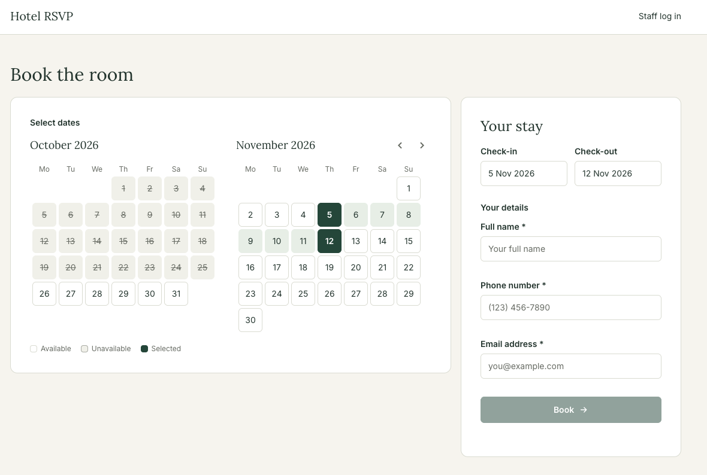
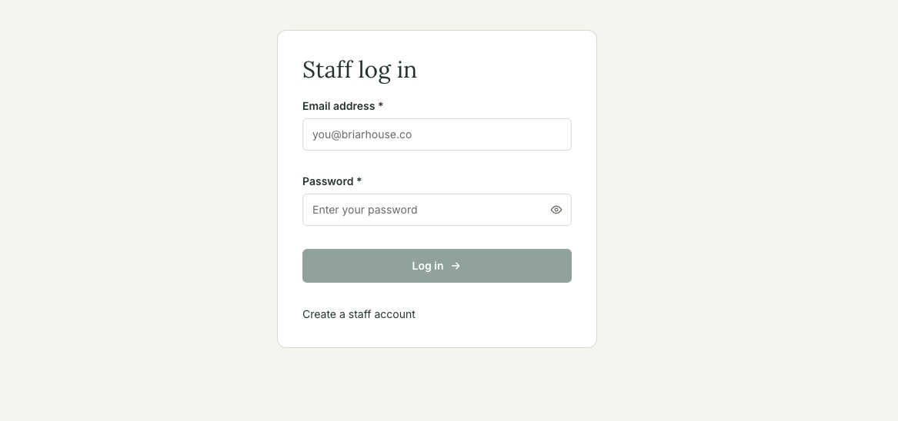
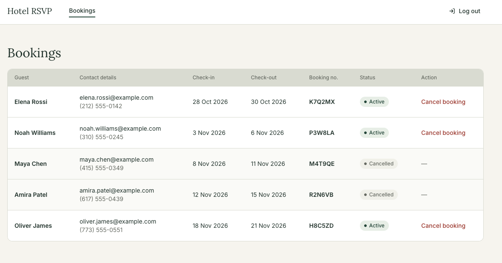

# hotel-rsvp-app

A simple booking web app for a single hotel with one room. Guests browse available dates and book the room. Hotel staff sign up, log in, view all bookings and cancel them.

## Screens

### Guest: book the room

Guests pick a check-in and check-out on the calendar, enter their name, phone and email, and get a booking number.

### Staff: log in

Staff log in with their email and password, or create a staff account.

### Staff: view and cancel bookings

Logged-in staff see every booking, active and cancelled, with the guest's contact details, dates and booking number. They can cancel an active booking after confirming, which opens its dates to guests again.

## Planning Process

1. Requirements
   - Functional
   - Nonfunctional
2. User Stories
3. Out of scope
4. Tech stack
5. Data model
6. API contract
7. File structure
   - Front end
   - Back end
8. Figma design
9. CI setup
10. Claude rules (CLAUDE.md)
11. Code
12. Testing
    - Automated
    - Manual

## How I Used AI

I built this with Claude and Claude Code as a collaborator, while making the decisions and reviewing the work myself.

**Planning.** I worked through the plan with Claude. While brainstorming, I asked it to list its assumptions and the tradeoffs of each option. I chose the option that fit the project, then had Claude write it up as a document in [`docs/`](docs/), so every later step had a written source of truth.

**Coding.** I used rules in `CLAUDE.md` files ([root](CLAUDE.md), [`web/`](web/CLAUDE.md), [`api/`](api/CLAUDE.md)) to keep Claude Code writing in the style I wanted. Whenever I saw a mistake, I added a new rule so it wouldn't happen again. For example:

- Reusable logic goes in a separate, tested helper function. Any input cleaning, such as trimming or lowercasing an email, is always a util.
- Fixed values and messages live in constants files, and shared types in types files.
- No comments in code, and braces on every `if`.
- My manual edits are kept, never reverted.

**Review.** Claude Code opened a pull request for each piece of work, and I reviewed every one. I read all the code to make sure I understood it, and asked Claude whenever I didn't.

## Design

- [Figma design](https://www.figma.com/design/y8tAJJMZDW2c5K0sspUj0D/Untitled?node-id=4-18643): every screen for guests and staff.

## Docs

- [Requirements](docs/requirements.md): users, functional and nonfunctional requirements, booking rules and User Stories.
- [Out of Scope](docs/out-of-scope.md): improvements left out of this build.
- [Tech Stack](docs/tech-stack.md): languages, frameworks, services and tools.
- [Data Model](docs/data-model.md): database collections and fields.
- [API Contract](docs/api-contract.md): API endpoints with requests and responses.
- [File Structure](docs/file-structure.md): front end and back end folders and files.
- [Manual Tests](docs/manual-tests.md): checklist for testing every functional requirement by hand, including error cases.

## Author

Created by [David Anusontarangkul](https://github.com/danusontarangkul).
